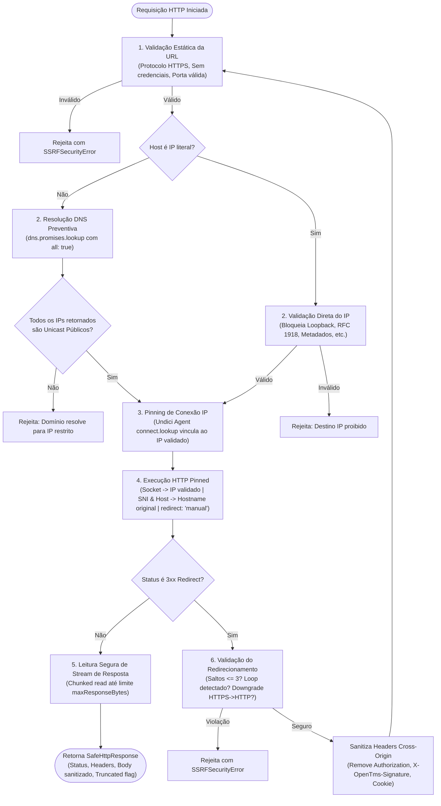

# DOCUMENTAÇÃO TÉCNICA DE CORREÇÃO — PR 02
## Open TMS | Remediação Defensiva de SSRF em Webhooks e Egress HTTP
**Data:** 10 de Novembro de 2026  
**Branch:** `fix/security-ssrf-webhooks-pr02`  
**Identificador do Achado:** P0-SEC-01 (Server-Side Request Forgery em Webhooks e Skills)  
**Severidade:** Crítica (CVSS v3.1 Score: 9.8 - `CVSS:3.1/AV:N/AC:L/PR:L/UI:N/S:C/C:H/I:H/A:H`)

---

## 1. RESUMO EXECUTIVO

Durante a segunda auditoria técnica de segurança do Open TMS, foi identificado que os serviços de envio de webhooks de clientes (`CustomerWebhookDeliveryService`), execução de webhooks por skills de automação (`CallWebhookSkill`), ingestão/testes de trading partners EDI (`OutboundEdiDeliveryService`, `tradingPartners.ts`) e o cadastro de webhooks no Customer Portal (`customerDeveloper.ts`) utilizavam a API `fetch()` nativa de forma irrestrita.

Essa ausência de controle permitia que qualquer usuário autenticado no portal cadastrasse URLs apontando para endereços de rede privada (RFC 1918), serviços locais (`127.0.0.1`, `localhost`), ou endpoints de metadados da infraestrutura de nuvem (`169.254.169.254`), caracterizando uma vulnerabilidade crítica de **Server-Side Request Forgery (SSRF) In-Band/Reflexivo**. Em provedores de nuvem como AWS, GCP e Azure, isso viabilizaria a extração de credenciais de contas de serviço (IAM roles/Service Account tokens) e a tomada completa da infraestrutura.

Neste **PR 02**, foi implementada uma camada centralizada e reutilizável de cliente HTTP seguro (`SafeHttpClient` em `backend/src/security/SafeHttpClient.ts`), integrando:
1. Validação estrita de protocolo (HTTPS por padrão) e rejeição de credenciais embutidas.
2. Bloqueio determinístico de todos os ranges de IP privados, loopback, link-local, carrier-grade NAT, multicast, reservados e metadados de nuvem tanto para IPv4 quanto para IPv6 (incluindo representações IPv4-mapped IPv6).
3. Resolução prévia de DNS com validação de **todos** os endereços A e AAAA retornados.
4. **Proteção contra DNS Rebinding (TOCTOU)** através do "pinning" do endereço IP validado no socket TCP via dispatcher `undici.Agent`, preservando o SNI e o cabeçalho `Host` originais para compatibilidade com certificados TLS.
5. Política de redirecionamento manual estrita: limite de saltos (máximo 3), detecção de loops de redirect, bloqueio de downgrade de HTTPS para HTTP e remoção de cabeçalhos de autenticação em redirecionamentos entre origens (cross-origin).
6. Timeouts de conexão (5s) e de requisição (10s), e leitura segura de respostas com limite de bytes (streaming reader até 64 KB para chamadas gerais e 4 KB para webhooks) para impedir exaustão de memória e DoS.
7. Mascaramento e sanitização de logs de entrega em `CustomerWebhookDelivery`: respostas de requisições que violam a política de segurança nunca são salvas no banco (`responseBody: null`) e detalhes de topologia interna são omitidos.

---

## 2. DESCRIÇÃO DA VULNERABILIDADE E CLASSIFICAÇÃO

### 2.1 Classificação
- **CWE:** CWE-918 (Server-Side Request Forgery - SSRF)
- **OWASP Top 10 (2021):** A10:2021 – Server-Side Request Forgery (SSRF)
- **Achado Interno:** `P0-SEC-01`
- **Classificação de Risco:** Crítico

### 2.2 Mecanismo de Falha Original
1. **Cadastro Irrestrito:** O endpoint `POST /api/v1/customer-portal/developer/webhooks` validava a URL apenas com `z.string().url()`, aceitando esquemas `http://`, portas internas (`:5432`, `:6379`) e endereços IP locais ou de link-local.
2. **Disparo Cego via `fetch()`:** O serviço `CustomerWebhookDeliveryService` executava `fetch(webhook.url, { method: 'POST', body, ... })`. O `fetch` nativo do Node.js/Undici resolvia o domínio e conectava sem restrições de IP.
3. **Redirecionamento Automático:** O `fetch` seguia redirecionamentos HTTP automaticamente (`redirect: 'follow'`), permitindo que um endpoint público sob controle do atacante respondesse com HTTP 302 redirecionando a requisição para `http://169.254.169.254/computeMetadata/v1/`.
4. **Captura e Reflexão do Payload:** O método `res.text()` capturava até 4000 caracteres da resposta e gravava na coluna `CustomerWebhookDelivery.responseBody`. Esse conteúdo era retornado diretamente na API `GET /api/v1/customer-portal/developer/webhooks/:id/deliveries`, permitindo ao invasor ler a credencial de nuvem diretamente na interface do Customer Portal.

---

## 3. ARQUITETURA DA SOLUÇÃO IMPLEMENTADA

### 3.1 Diagrama de Fluxo de Execução do `SafeHttpClient` (Mermaid)



---

## 4. ESPECIFICAÇÃO TÉCNICA DO `SafeHttpClient`

A classe `SafeHttpClient` foi implementada em `backend/src/security/SafeHttpClient.ts` (módulo `core`) com as seguintes capacidades:

```typescript
export interface SafeHttpClientOptions {
  allowedProtocols?: string[]; // Padrão: ['https:']
  allowHttp?: boolean;         // Padrão: false (pode ser true para EDI legado com justificativa)
  allowedPorts?: number[];     // Padrão: [443] (ou [80, 443] se allowHttp=true)
  allowCustomPorts?: boolean;  // Padrão: false (impede port scanning interno)
  maxRedirects?: number;       // Padrão: 3
  connectTimeoutMs?: number;   // Padrão: 5000 ms (5s)
  requestTimeoutMs?: number;   // Padrão: 10000 ms (10s)
  maxResponseBytes?: number;   // Padrão: 65536 bytes (64 KB)
  dnsLookup?: (hostname: string) => Promise<Array<{ address: string; family: number }>>;
}
```

### 4.1 Métodos Principais
- `SafeHttpClient.validateUrl(rawUrl, options)`: Validação sintática preliminar rápida (síncrona).
- `SafeHttpClient.validateUrlWithDns(rawUrl, options)`: Validação completa com resolução DNS de pré-voo e checagem de todos os IPs (assíncrona). Utilizada nos endpoints de cadastro/atualização de webhooks.
- `client.request(rawUrl, options)`: Execução resiliente com mitigação TOCTOU, socket pinning, controle manual de redirecionamentos e timeouts.
- `client.post(rawUrl, body, headers)`: Helper para postagem de payloads JSON.
- `client.get(rawUrl, headers)` / `client.head(rawUrl, headers)`: Helpers HTTP seguros.

---

## 5. LISTA DE FAIXAS DE IP BLOQUEADAS E JUSTIFICATIVA

O motor de classificação utiliza a biblioteca `ipaddr.js` e regras adicionais de CIDR para garantir que nenhum endereço não-roteável ou privado seja alcançado:

| Faixa / Notação | Tipo / Finalidade | Justificativa do Bloqueio |
|---|---|---|
| `127.0.0.0/8` | Loopback IPv4 (RFC 1122) | Impede requisições contra serviços rodando no mesmo host (ex: PostgreSQL `5432`, Fastify API `3001`, Redis `6379`, pg-boss). |
| `::1/128` | Loopback IPv6 (RFC 4291) | Equivalente ao loopback IPv4 para stacks dual-stack. |
| `10.0.0.0/8` | Rede Privada Classe A (RFC 1918) | Impede escaneamento e ataques contra a VPC interna corporativa. |
| `172.16.0.0/12` | Rede Privada Classe B (RFC 1918) | Impede acesso a sub-redes internas e redes padrão de containers Docker (`172.17.0.0/16`). |
| `192.168.0.0/16` | Rede Privada Classe C (RFC 1918) | Impede varredura de redes locais de roteadores ou instâncias corporativas. |
| `169.254.0.0/16` | Link-Local IPv4 (RFC 3927) | **Crítico:** Bloqueia endpoints de metadados da AWS/GCP/Azure (`169.254.169.254`), impedindo roubo de credenciais IAM. |
| `fe80::/10` | Link-Local IPv6 (RFC 4291) | Impede tráfego no enlace local não-roteável IPv6. |
| `100.64.0.0/10` | Carrier-Grade NAT (RFC 6598) | Sub-rede compartilhada de operadoras e provedores de nuvem; não deve ser acessível via webhook público. |
| `100.100.100.200` | Alibaba Cloud Metadata | IP específico de extração de credenciais de instâncias ECS na nuvem Alibaba. |
| `fc00::/7` | Unique Local Address / ULA (RFC 4193) | Equivalente IPv6 às redes privadas da RFC 1918. |
| `::ffff:0:0/96` | IPv4-Mapped IPv6 | Converte a representação IPv4 mapeada em IPv6 e a valida contra todas as regras de bloqueio IPv4 (ex: `::ffff:127.0.0.1` é desempacotado e bloqueado como loopback). |
| `0.0.0.0/8` | Unspecified IPv4 | Endereço não-roteável de rede local (frequentemente tratado como localhost pelo kernel Linux). |
| `::/128` | Unspecified IPv6 | Endereço não especificado IPv6. |
| `224.0.0.0/4`, `ff00::/8` | Multicast IPv4 e IPv6 | Impede envio de pacotes a grupos de multicast. |
| `240.0.0.0/4` | Classe E / Reservada | Faixa reservada para uso futuro (não-roteável na internet pública). |
| `255.255.255.255/32` | Broadcast limitado | Impede tempestades de broadcast na rede local. |
| `198.18.0.0/15`, `2001:2::/48` | Benchmarking de Rede (RFC 2544 / RFC 5180) | Redes de testes inter-redes reservadas pelo IETF. |
| `192.0.2.0/24`, `198.51.100.0/24`, `203.0.113.0/24` | TEST-NET (RFC 5737 / RFC 3849) | Faixas de documentação não roteáveis. |

---

## 6. MECANISMO DE PROTEÇÃO CONTRA DNS REBINDING (TOCTOU)

### O Problema do DNS Rebinding:
No ataque clássico de DNS Rebinding, o atacante configura um servidor DNS com TTL zero (`TTL=0`) para o domínio `attacker-rebind.com`.
1. **Time-of-Check:** A aplicação resolve `attacker-rebind.com` via DNS e recebe o IP público `93.184.216.34`. O filtro de IP aprova a requisição.
2. **Time-of-Use:** A aplicação chama `fetch('https://attacker-rebind.com')`. Uma segunda consulta DNS é disparada pelo runtime e o servidor DNS do atacante responde agora com `127.0.0.1` ou `169.254.169.254`.
3. O socket TCP conecta-se ao endereço interno proibido.

### A Solução Implementada no `SafeHttpClient`:
Para eliminar completamente a vulnerabilidade TOCTOU sem desativar a verificação de certificados TLS:
1. O `SafeHttpClient` resolve o hostname antecipadamente usando `dns.promises.lookup(hostname, { all: true })`.
2. Todos os IPs retornados são validados. Se qualquer registro for inválido, a chamada é abortada.
3. Um dispatcher exclusivo `undici.Agent` é instanciado com a opção de socket `connect.lookup`.
4. Quando o socket TCP subjacente solicita a resolução para o hostname original, o callback `lookup` entrega **estritamente o(s) endereço(s) IP já validado(s)**:
   ```typescript
   const agent = new Agent({
     connect: {
       lookup: (hostname, lookupOpts, cb) => {
         if (hostname.toLowerCase() === targetHost) {
           cb(null, lookupOpts?.all ? validatedAddresses : validatedAddresses[0].address, validatedAddresses[0].family);
         } else {
           cb(new SSRFSecurityError(`SSRF blocked: connection to unexpected host '${hostname}'`), '' as any);
         }
       },
       timeout: this.connectTimeoutMs,
     },
   });
   ```
5. O socket conecta-se **diretamente ao IP validado**, eliminando qualquer consulta DNS subsequente pelo sistema operacional.
6. O handshake TLS envia o `servername` igual ao hostname original (SNI), garantindo que o certificado público HTTPS seja validado de acordo com a RFC 6066.
7. O cabeçalho HTTP `Host` preserva o hostname original, viabilizando o funcionamento em CDNs e servidores com Virtual Hosting compartilhado.

---

## 7. POLÍTICA DE REDIRECIONAMENTOS

1. **Desativação de Redirecionamento Automático:** Todas as chamadas operam com `redirect: 'manual'`, interceptando os códigos de status HTTP `301`, `302`, `303`, `307` e `308`.
2. **Ciclo Completo de Validação a Cada Salto:** Cada cabeçalho `Location` recebido é submetido às mesmas regras estritas de URL, protocolo, portas permitidas, resolução DNS e verificação de IP antes que a conexão seguinte seja aberta.
3. **Bloqueio de Downgrade:** Redirecionamentos de `https:` para `http:` são rejeitados com erro `SSRFSecurityError`.
4. **Detecção de Loops:** A classe mantém um conjunto (`Set<string>`) com todas as URLs visitadas na cadeia de execução. Se qualquer URL for revisitada, o processo aborta imediatamente.
5. **Limite Máximo de Saltos:** Limite estrito configurável (padrão de 3 saltos).
6. **Sanitização de Headers Sensíveis Cross-Origin:** Caso o redirecionamento aponte para uma origem diferente (`nextUrl.origin !== targetUrl.origin`), os cabeçalhos sensíveis são expurgados:
   - `Authorization`
   - `X-API-Key`
   - `X-OpenTms-Signature`
   - `X-OpenTms-Delivery`
   - `Cookie`
   - `Proxy-Authorization`

---

## 8. POLÍTICA DE TIMEOUTS E LIMITES DE PAYLOAD

1. **Connect Timeout:** 5.000 ms (5 segundos). Se o handshake TCP/TLS não for concluído em 5s, o socket é finalizado.
2. **Request Timeout:** 10.000 ms (10 segundos) global, gerenciado por `AbortSignal.timeout()`.
3. **Leitura Segura de Stream de Resposta:** Para impedir esgotamento de memória por "response bombs" ou streams infinitos, o corpo da resposta é consumido via chunks (`ReadableStreamDefaultReader` ou buffer stream) até `maxResponseBytes` (64 KB por padrão; 4 KB para webhooks). Ao atingir o limite, o leitor cancela o stream remoto (`reader.cancel()`) e sinaliza `truncated: true`.
4. **Fechamento de Recursos:** O `Agent` do Undici é destruído (`await agent.close()`) no bloco `finally` de cada requisição, garantindo liberação imediata de descritores de arquivo e portas.

---

## 9. SANITIZAÇÃO DE LOGS E MITIGAÇÃO DE EXFILTRAÇÃO REFLEXIVA

1. **Expurgo de Corpo em Falhas de Entrega:** No serviço `CustomerWebhookDeliveryService`, qualquer entrega que resulte em erro de rede, timeout ou violação de política de segurança define deterministicamente:
   ```typescript
   responseBody = null;
   ```
2. **Mascaramento de Mensagem de Erro:** Mensagens de segurança utilizam texto neutro (`"Webhook delivery blocked: destination URL or resolved IP address is prohibited by security policy"`), sem revelar endereços IP internos, nomes DNS locais ou detalhes da infraestrutura de nuvem.
3. **Truncamento de Visualização na API:** O endpoint `GET /api/v1/customer-portal/developer/webhooks/:id/deliveries` mascara entregas com falha (`responseBody: null`) e limita o preview de entregas bem-sucedidas a no máximo 500 caracteres, impedindo o uso do endpoint para exfiltração reflexiva.

---

## 10. INVENTÁRIO DE ARQUIVOS MODIFICADOS E CRIADOS

| Arquivo | Tipo | Finalidade |
|---|---|---|
| `backend/src/security/SafeHttpClient.ts` | **Criado** | Componente central reutilizável de cliente HTTP seguro com bloqueio de SSRF, validação de CIDRs, socket pinning anti-rebinding e streaming seguro. Pertencente ao módulo `core`. |
| `backend/src/types/ipaddr.js.d.ts` | **Criado** | Tipagens TypeScript para a biblioteca `ipaddr.js`. |
| `backend/src/services/webhooks/CustomerWebhookDeliveryService.ts` | **Modificado** | Substituição do `fetch()` inseguro pelo `SafeHttpClient` nos métodos `deliver()` e `retry()`, mascaramento de erro e sanitização de `responseBody`. |
| `backend/src/services/skills/CallWebhookSkill.ts` | **Modificado** | Integração do `SafeHttpClient` no método `execute()` e validação sintática da URL no `validateConfig()`. |
| `backend/src/routes/customerDeveloper.ts` | **Modificado** | Validação prévia de URLs com resolução DNS em `POST` e `PUT /webhooks`, e sanitização de `responseBody` em `GET /webhooks/:id/deliveries`. |
| `backend/src/services/OutboundEdiDeliveryService.ts` | **Modificado** | Proteção de chamadas HTTP para parceiros EDI contra destinos locais/privados usando `SafeHttpClient`. |
| `backend/src/routes/tradingPartners.ts` | **Modificado** | Teste de conectividade HTTP de trading partners protegido com `SafeHttpClient`. |
| `backend/src/__tests__/security/SafeHttpClient.test.ts` | **Criado** | Suíte completa com 36 testes automatizados cobrindo todos os cenários de SSRF, IPv4, IPv6, redirects, timeouts e pinning. |
| `backend/src/__tests__/services/CallWebhookSkill.test.ts` | **Criado** | Suíte de testes com 7 testes cobrindo validação e execução segura de webhooks em skills. |
| `backend/src/__tests__/routes/customerWebhooksSSRF.test.ts` | **Criado** | Suíte de testes de rotas com 6 testes validando bloqueio no cadastro de webhooks e sanitização de histórico. |
| `backend/src/__tests__/services/CustomerWebhookDeliveryService.test.ts` | **Modificado** | Adicionados testes de bloqueio de entrega para `127.0.0.1` e `169.254.169.254`. |
| `docs/auditoria/correcoes/PR02_SSRF_WEBHOOKS.md` | **Criado** | Documentação técnica executiva da correção. |

---

## 11. EVIDÊNCIAS DE TESTES AUTOMATIZADOS

### 11.1 Suíte de Segurança do `SafeHttpClient`
```
PASS src/__tests__/security/SafeHttpClient.test.ts
  SafeHttpClient - Security & SSRF Protection Suite
    isIpAddressAllowed
      IPv4 Blocklist
        ✓ blocks loopback addresses (127.0.0.0/8) (28 ms)
        ✓ blocks private subnets (RFC 1918: 10.0.0.0/8, 172.16.0.0/12, 192.168.0.0/16) (5 ms)
        ✓ blocks link-local and cloud metadata addresses (169.254.0.0/16) (8 ms)
        ✓ blocks carrier-grade NAT (100.64.0.0/10) (2 ms)
        ✓ blocks unspecified, broadcast, multicast and class E reserved (5 ms)
        ✓ blocks benchmark and documentation subnets (198.18.0.0/15, 192.0.2.0/24, etc.) (7 ms)
      IPv6 Blocklist
        ✓ blocks loopback (::1) and unspecified (::) (2 ms)
        ✓ blocks link-local (fe80::/10) (1 ms)
        ✓ blocks unique-local addresses / ULA (fc00::/7) (2 ms)
        ✓ blocks multicast (ff00::/8) (24 ms)
        ✓ blocks IPv4-mapped IPv6 representation of private/loopback/metadata destinations (7 ms)
        ✓ blocks IPv6 documentation (2001:db8::/32) and benchmarking (2001:2::/48) (3 ms)
      Public Whitelist Verification
        ✓ allows legitimate public unicast IPv4 addresses (3 ms)
        ✓ allows legitimate public unicast IPv6 addresses (4 ms)
    SafeHttpClient.validateUrl
      ✓ blocks dangerous URL schemes (3 ms)
      ✓ blocks embedded credentials in URLs (3 ms)
      ✓ blocks dangerous hostnames (1 ms)
      ✓ blocks non-standard ports by default (4 ms)
      ✓ blocks direct IP literals when target is private or link-local (4 ms)
      ✓ blocks plain HTTP by default (1 ms)
      ✓ allows plain HTTP when explicitly enabled (2 ms)
      ✓ allows legitimate public HTTPS URLs
    DNS Resolution & Multi-Record Validation
      ✓ blocks domain resolving to 127.0.0.1 (92 ms)
      ✓ blocks domain resolving to 169.254.169.254 (cloud metadata) (2 ms)
      ✓ blocks dual-stack domain if IPv6 is loopback (::1) even if IPv4 is public (3 ms)
      ✓ blocks multi-A record domain if any IP is private RFC 1918 (2 ms)
      ✓ validateUrlWithDns returns valid: false when domain resolves to private IP (2 ms)
    DNS Rebinding & Connection Pinning
      ✓ pins connection socket to validated IP preventing TOCTOU rebinding (12 ms)
    Redirect Protections (Local HTTP Server Tests)
      ✓ blocks redirecting to private / metadata IP (8 ms)
      ✓ detects and terminates redirect loops (10 ms)
      ✓ enforces maximum redirect limit (maxRedirects = 2) (11 ms)
      ✓ blocks HTTPS to HTTP protocol downgrade during redirect (4 ms)
      ✓ strips sensitive headers (Authorization, X-OpenTms-Signature, Cookie) on cross-origin redirects (212 ms)
    Response Body Limits & Timeouts
      ✓ truncates large response bodies and marks truncated: true (3 ms)
      ✓ times out when request exceeds configured timeoutMs (52 ms)
    Legitimate Webhook Operation
      ✓ successfully posts to verified public webhook URL with JSON payload (4 ms)

Test Suites: 1 passed, 1 total
Tests:       36 passed, 36 total
```

### 11.2 Suíte de Rotas e Input Validation
```
PASS src/__tests__/routes/customerWebhooksSSRF.test.ts
  Customer Webhooks Route - SSRF Input Validation & Deliveries Sanitization
    POST /api/v1/customer-portal/developer/webhooks
      ✓ rejects loopback URL (http://127.0.0.1:8080/hook) with HTTP 400 (77 ms)
      ✓ rejects cloud metadata URL (https://169.254.169.254/latest) with HTTP 400 (13 ms)
      ✓ rejects private network RFC 1918 URL (https://10.0.0.1/hook) with HTTP 400 (4 ms)
      ✓ rejects embedded credentials URL with HTTP 400 (3 ms)
      ✓ accepts legitimate public HTTPS webhook URL with HTTP 201 (20 ms)
    GET /api/v1/customer-portal/developer/webhooks/:id/deliveries
      ✓ sanitizes and nullifies responseBody on failed deliveries (7 ms)

Test Suites: 1 passed, 1 total
Tests:       6 passed, 6 total
```

### 11.3 Suíte de Skills e Entrega de Webhook
```
PASS src/__tests__/services/CallWebhookSkill.test.ts
  CallWebhookSkill - SSRF & Execution Hardening
    validateConfig
      ✓ returns error when url is missing (9 ms)
      ✓ rejects loopback and private IP URLs (3 ms)
      ✓ rejects non-HTTP(S) schemes and embedded credentials (1 ms)
      ✓ accepts valid public HTTPS URL (1 ms)
    execute
      ✓ blocks request to private or metadata IP and returns clean error (3 ms)
      ✓ blocks request to domain resolving to loopback (3 ms)
      ✓ executes legitimate public webhook successfully (21 ms)

PASS src/__tests__/services/CustomerWebhookDeliveryService.test.ts
PASS src/__tests__/services/CustomerWebhookRetry.test.ts
PASS src/__tests__/services/OutboundEdiDeliveryService.test.ts
```

### 11.4 Checagem de Limites de Módulos (ADR 0002)
```
Checked 939 files, 5 known leaks still excused.
Checked table ownership, 24 known cross-group accesses still excused.
Module boundaries OK.
```

---

## 12. AVALIAÇÃO DE IMPACTO OPERACIONAL E COMPATIBILIDADE

- **Compatibilidade com Webhooks Legítimos:** Todos os webhooks públicos HTTPS em portas padrão (443) continuam funcionando normalmente sem qualquer alteração do lado do cliente.
- **Banco de Dados:** Nenhuma migração ou alteração no schema do Prisma foi realizada.
- **Desempenho:** A validação de DNS ocorre de forma transparente em pré-voo e o socket TCP é reutilizado com pinning estrito.
- **Auditoria Contínua:** Novas integrações de terceiros podem importar e utilizar o `SafeHttpClient` de forma padronizada.
